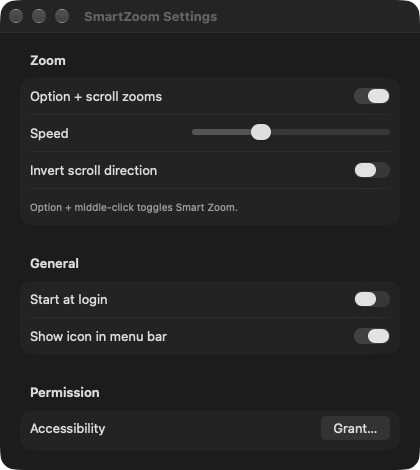

# SmartZoom

**[Download SmartZoom-1.0.0.dmg](https://github.com/ivorpad/smartzoom/releases/download/v1.0.0/SmartZoom-1.0.0.dmg)**

Hold Option and scroll to zoom the app under the pointer, the way a trackpad pinch does. Safari, Preview and other apps redraw at full resolution, so text stays sharp. The built-in Accessibility Zoom (Control + scroll) only enlarges screen pixels, which is why it looks blurry.

- **Option + scroll**: zoom in and out (sends pinch gestures)
- **Option + middle-click**: Smart Zoom, the same as a two-finger double-tap on a trackpad

It lives in the menu bar. Settings has scroll speed, direction, start at login and an option to hide the menu bar icon. To get the icon back, open SmartZoom again from Applications or Spotlight.

## Where it works

Only in apps that handle trackpad pinch and Smart Zoom: Safari, Chrome, Firefox, Preview, Maps, Photos, Pages, Keynote, Figma, most PDF viewers. Terminal, Finder lists and most settings panes ignore pinch gestures, so nothing happens there. macOS has no public API that makes every app redraw at a larger size.

## Install

Open the [DMG](https://github.com/ivorpad/smartzoom/releases/latest), drag SmartZoom to Applications and open it. macOS asks for Accessibility permission (System Settings > Privacy & Security > Accessibility). SmartZoom needs it to read the scroll wheel and post gesture events.

Requires macOS 15 or later. Tested on macOS 27.0.1. The app runs natively on both Apple silicon and Intel.

## How it works

A `CGEventTap` catches scroll events while Option is held, blocks them and posts gesture events instead. macOS has no public API for creating gesture events, so SmartZoom sets undocumented `CGEvent` fields:

| Field | Value |
|---|---|
| 55 (event type) | 29, `NSEventTypeGesture` |
| 110 (HID event type) | 8 for pinch, 22 for Smart Zoom |
| 113 | magnification amount (double) |
| 132 (phase) | 1 began, 2 changed, 4 ended |

The field numbers come from [Mac Mouse Fix](https://github.com/noah-nuebling/mac-mouse-fix), which found them by studying Calftrail's TouchSynthesis. Apple can change them in any macOS release. macOS 27 already stopped honoring the equivalent fields for Dock swipes. If zooming stops working after an update, that's the first place to look.

The app needs Accessibility access, so it can't run in the App Store sandbox.

## License

MIT. The icon artwork in `SmartZoom/AppIcon.icon` is original and under the same license.
